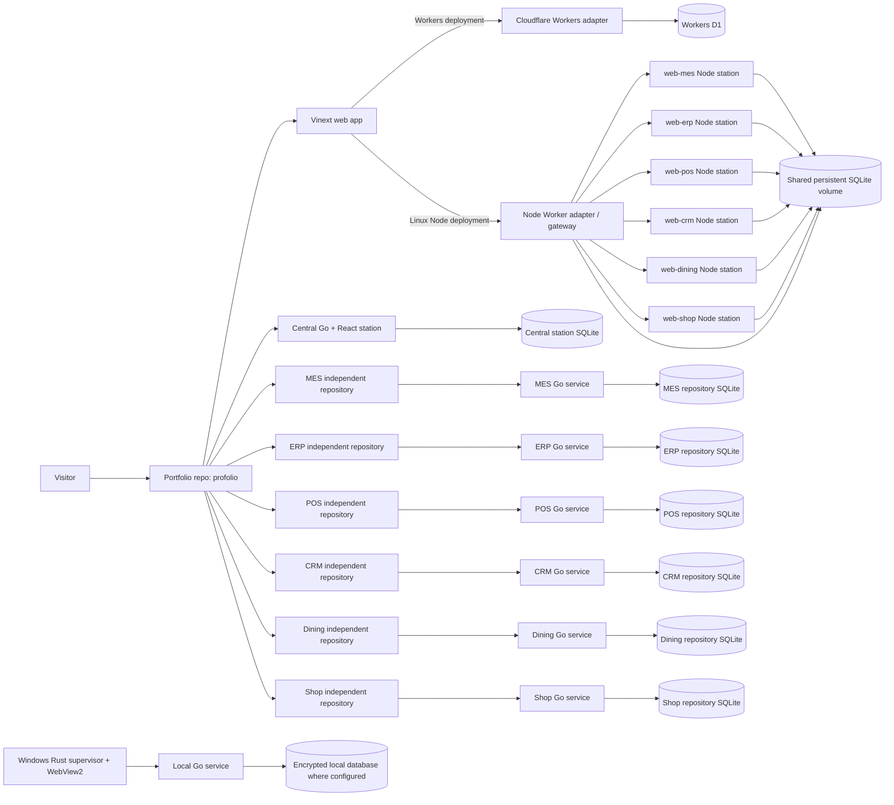

# Business Suite Construction and System Map

**Evidence baseline:** freshly fetched portfolio `origin/main` at `ed867fa` on 2026-11-20 (Asia/Taipei). Subsystem dark/light theme separation and full Traditional Chinese localization integrated across Next.js and Go Station. This document maps the source tree and links to existing status records. Deployment and acceptance statements are snapshots from the cited records, not a live host check. Confirm the target repository branch, current CI, release revision, and service health before calling an item current.

Related delivery documents: [Handoff](HANDOFF.md), [Development plan](DEVELOP_PLAN.md), and [Harness](HARNESS.md). Existing architecture and evidence references include [Architecture handoff](ARCHITECTURE_HANDOFF.md), [Development status](DEVELOPMENT_STATUS.md), [Acceptance matrix](ACCEPTANCE.md), [API contract](API.md), and [Linux deployment](../infra/linux/README.md).

## System topology

There are multiple implementations with different maturity and data stores. A shared hostname or portfolio card does not mean that implementations share identity, database, or transaction state.

The Workers and Linux Node paths are separate deployment adapters for the Portfolio web app. In the Linux Node topology, the six `web-<site>` station processes share the same persistent SQLite volume; they are process/routing boundaries, not six separate databases. Each independent repository Go service has its own service/schema/data boundary. The diagram does not claim that every independent service is currently deployed or publicly routed.

### Portfolio repository (`profolio`)

This repository contains the public portfolio, an existing Vinext/Workers web application, the central Go station, and the newer Go/React/Rust desktop work. These are distinct surfaces:

- `app/`, `lib/`, `db/`, `drizzle/`, `worker/`, and `middleware.ts` implement the web application, request-scoped data binding, demo identity, and migrations. `lib/portfolio-experience.ts` and `lib/portfolio-translations.ts` provide unified Traditional Chinese (zh-TW) localization and Dark/Light mode theme switching across all public workspaces (`/mes`, `/erp`, `/pos`, `/crm`, `/dining`, `/shop`, `/commerce`, `/platform`). The README describes a Workers/D1 path and a Linux Node/SQLite adapter path; these are separate deployment adapters.
- `backend/` contains the central Go HTTP/API implementation, station dispatch, business modules, tests, and migrations. `backend/main.go`, `backend/stations.go`, and domain files such as `backend/pos_business.go` and `backend/mes_work_order.go` are useful entry points.
- `web/src/` contains React station interfaces. `desktop/` contains the desktop wrapper/supervisor sources; packaging and user-machine behavior must be checked separately from CI artifacts.
- `infra/` contains Compose, gateway, service graph and deployment scripts. Read the matching runbook before operating any host.

The same product names appear in these surfaces, but data is not automatically shared. Workers D1, the Linux Node web stations' shared SQLite volume, central station SQLite, independent repository databases, and Windows local databases are separate stores. A feature implemented in one does not imply migration to the others.

## Repository map

The verified portfolio source of public repository URLs is [`lib/project-repositories.ts`](../lib/project-repositories.ts). The six links are:

| Domain | Repository | Independent Repo & Portfolio code landmarks |
|---|---|---|
| MES / ForgeFlow | [business-suite-mes](https://github.com/Davis1233798/business-suite-mes) | `backend/mes_*.go`, `web/src/Mes*.tsx`; 獨立 repo 具備多工序追加、完工量依最高工序累積保護、全單報廢守恆與 M08 OEE 計算 (`mes_oee.go`, `mes_business.go`) |
| ERP / LedgerWorks | [business-suite-erp](https://github.com/Davis1233798/business-suite-erp) | `backend/erp_*.go`, `web/src/Erp*.tsx`; 獨立 repo 具備會計期間關帳防竄改 (`fiscal_period.go`)、防負庫存觸發器、調撥守恆與 E08 移動平均成本計算 |
| POS / CounterPoint | [business-suite-pos](https://github.com/Davis1233798/business-suite-pos) | `backend/pos_*.go`, `web/src/Pos*.tsx`; 獨立 repo 具備 P07 會員消費者配對 (`pos_consumer_pairing.go`)、結帳關聯綁定與 Outbox 交易同步 |
| CRM / RelationDesk | [business-suite-crm](https://github.com/Davis1233798/business-suite-crm) | `backend/crm_*.go`, `web/src/Crm*.tsx`; 獨立 repo 具備 R06 台北客服 SLA 週末跳過 (`crm_support.go`)、潛客重複檢測與合併審批 (`stations.go`) 及 GDPR 同意撤回即刻排除 |
| Dining / TableCraft | [business-suite-dining](https://github.com/Davis1233798/business-suite-dining) | `backend/dining_*.go`, `web/src/Dining*.tsx`; 獨立 repo 具備桌位 90 分鐘衝突保護、KDS 單向出餐狀態機、D07 服務費拆單結算守恆與退款反向台帳 |
| Shop / MarketLane | [business-suite-shop](https://github.com/Davis1233798/business-suite-shop) | `backend/shop_*.go`, `web/src/Shop*.tsx`; 獨立 repo 具備 S04 優惠券餘數倒序分攤與配額原子扣減 (`shop_checkout.go`)、結帳防超賣並發保護 (409) 與退款反向台帳 |

The independent repositories have separate branches, CI, release histories, migrations and runtime state. The portfolio implementation is not an automatic mirror of them. Confirm the selected repo and target branch before a change; do not infer independent-repo status from this portfolio checkout.

## Data and identity boundaries

### Vinext / Workers web demo

The README describes a server-issued `demo_session_id` HttpOnly cookie that identifies a demo organization, and a UI role selector for role simulation. Caller-supplied organization/user/role headers are not the identity source. This is an isolated demonstration sandbox, not production employee authentication or enterprise RBAC. Demo roles must not be represented as trusted production credentials. The web application uses its own D1 binding and migration set (`drizzle/`).

### Central station

The portfolio's Go API issues station sessions and checks site, account, tenant and role in the API. Its database/migrations are under `backend/`. The central station data is separate from the web application's data and from independent system databases. A public demonstration identity, where configured, is only for the demonstration station.

### Independent station repositories

Each system repository owns its code, schema/migrations, CI and deployment artifacts. The station's authentication and tenant checks are implemented in that station; they do not inherit the demo cookie or central station sessions. Migration between the portfolio web app, central station and independent service requires a deliberate, validated data migration. Do not copy/overwrite production databases as a deployment step.

### Windows desktop

The desktop client/supervisor and local Go service are another boundary. CI packaging is not evidence of successful installation, identity setup, encryption/recovery, migration, or connection on a user's Windows machine. `docs/engineering/GO_REACT_DESKTOP.md` records the architecture and separately lists pending acceptance. Follow that document and the current per-repository documentation for cryptographic claims; do not infer data portability across Windows users or systems.

## Business transaction flows

The central station's current code is the actionable source for its transaction handlers. The Vinext app has separate TypeScript services/APIs, and the independent repositories have their own implementations. Use the corresponding implementation and tests when describing or changing a flow.

| Domain | Main flow represented in the product | Useful central station landmarks |
|---|---|---|
| MES | BOM / work order → materials → production reporting → quality and downtime → finished goods | `backend/mes_work_order.go`, `mes_operations.go`, `mes_finished_goods.go` |
| ERP | purchasing/receiving → stock ledger; sales/shipping → receivables/payables, journals and counts | `backend/erp_*.go`; `backend/mes_erp_mapping.go` for the separately implemented MES receipt mapping |
| POS | register shift → sale/hold/retrieve → payment/change → return/receipt/report | `backend/pos_business.go`, `pos_cart.go`, `pos_daily_report.go` |
| CRM | leads and contacts → opportunities/quotes/activity/support → consent and service follow-up | `backend/crm_*.go` |
| Dining | table/reservation/order → kitchen workflow → split settlement/refund | `backend/dining_*.go` |
| Shop | catalog/cart/coupon/checkout → simulated payment → fulfillment/refund | `backend/shop_*.go` |

These names summarize implemented domain areas; they are not a blanket claim that every planned feature is complete. For per-flow evidence and limits, use [Acceptance](ACCEPTANCE.md), [Development status](DEVELOPMENT_STATUS.md), and system-repository tests/CI.

## Deployment paths and evidence boundaries

1. **Web demo:** `README.md` documents local Workers/D1 setup. `infra/linux/README.md` documents the Node/SQLite adapter and shared gateway. A successful local build or test does not prove a cloud release.
2. **Central Go station:** `backend/` and `web/` build the station and static UI. CI artifacts are release inputs; host health/revision and browser flow require separate checks.
3. **Independent station services:** each repository controls its own workflow and artifacts. Some host deployments and public routes have progressed independently. Check that repository's workflow, release revision, host health, DNS/TLS and user flows before claiming it is live.
4. **Windows desktop:** CI packaging and startup smoke checks do not establish user installation, durable data, recovery or device validation.

`docs/DEVELOPMENT_STATUS.md` is an evidence snapshot updated through 2026-11-15 for several CI/deployment facts, while the portfolio public endpoint observation there is dated 2026-11-04. Verify live state before using either as current. `docs/engineering/DOMAIN_STATUS.md` also contains conflicting historical entries; do not use it alone to assert present public availability. ERP routing instructions are in [`ERP_PUBLIC_ROUTING.md`](engineering/ERP_PUBLIC_ROUTING.md), and station package caveats are in [`STATION-DELIVERY.md`](engineering/STATION-DELIVERY.md).

## Planned work versus verified work

- `docs/PLAN.md` is a requirements and acceptance plan. Its original status language does not describe the present repository state.
- `docs/ACTIVE_DEVELOPMENT.md` and `docs/DEVELOPMENT_STATUS.md` track work in progress and evidence; read their dates and distinctions between merged code, CI, deployed revision, and user-facing acceptance.
- `docs/ACCEPTANCE.md` identifies test and acceptance evidence. A passing unit/API check proves only the tested layer; it does not prove production data migration, external routing, UI, real integrations, or real-device behavior.
- Production payment, mail, shipping, invoicing and similar external effects are simulated unless the specific system documents and verifies a real adapter. Demo tenant/role behavior must not be described as production identity.
- Shared inventory, cross-repository synchronization, full legacy data migration, and features marked planned or in progress remain planned until source, tests and deployment evidence demonstrate otherwise.

When reporting a status, name the layer and evidence date: source implementation, CI, deployment revision, API/host health, or browser/user-flow acceptance. Mark unknowns explicitly.
